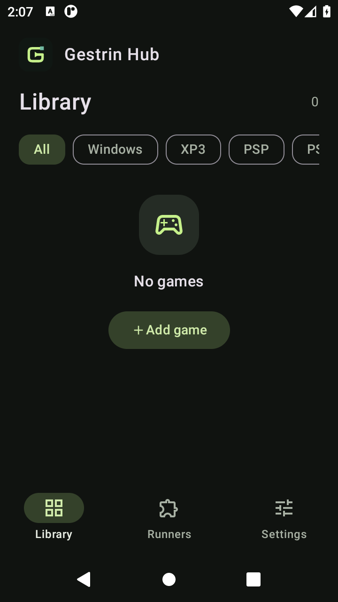
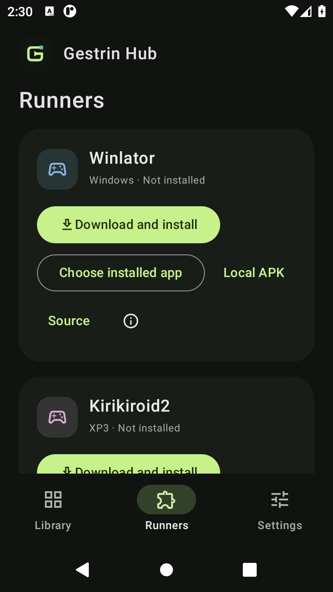
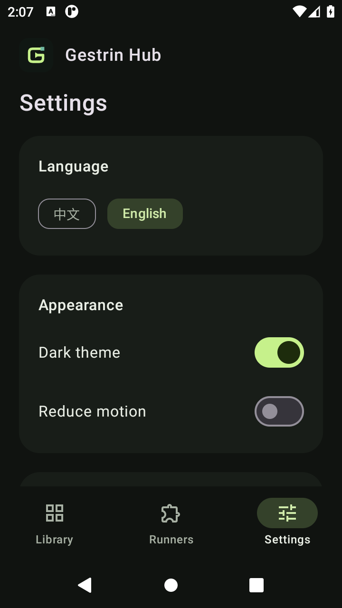

<p align="center"></p>

# Gestrin Hub

[English](#english) · [简体中文](#简体中文)


[](LICENSE)
[](https://github.com/Byton-Patrica/Gestrin-hub/actions/workflows/android.yml)

## English

An Android game library for phones and tablets. Organize local games, manage external runners, and keep compatibility notes in one place.

**v0.1 is a preview.** Five platform categories are included in the library and runner catalog. Actual game compatibility still needs testing on each device and runner version.

**Preview.3 (2026-10-20):** launch actions now show explicit options instead of silently opening a runner's home screen. Bind any launchable installed app, use Android's file handler chooser, or import a local standalone APK without using Hub's downloader. Local APKs still go through signature/device checks and Android's installer; binding an app does not make it compatible. The old official Kirikiroid2 1.3.9 package ID is corrected, but its effective target API 11 prevents new installation on Android 14+. See the [fix record](docs/10-runner-fixes.md).

<p align="center">
  
  
  
</p>

### Features

- Import local files or folders, group game projects, search, favorite, and edit titles, platforms and covers.
- Download and install external runners on demand, with progress, retry, cancellation, update checks and package verification.
- Back up and restore library metadata; record session observations and inspect redacted logs with local diagnostic rules.
- Switch between English and Simplified Chinese; choose light/dark themes and reduced animation.
- Responsive layouts for phones and tablets, including a side rail and detail pane on wider screens.

### Runner support

| Platform | Upstream | Current v0.1 integration |
| --- | --- | --- |
| Windows | [Winlator](https://github.com/brunodev85/winlator) | Opens the runner; configure containers and game shortcuts there. |
| XP3 / KiriKiri | [Kirikiroid2](https://github.com/zeas2/Kirikiroid2) | Opens the runner; select the game inside it. |
| PSP | [PPSSPP](https://github.com/hrydgard/ppsspp) | Attempts a file handoff to an installed runner. |
| PS Vita | [Vita3K](https://github.com/Vita3K/Vita3K) | Optional title-ID handoff for games already installed in Vita3K. |
| Nintendo Switch | [Eden](https://git.eden-emu.dev/eden-emu/eden) | Attempts a file handoff; upstream availability and compatible builds require verification. |

An installed runner or a successful handoff does not establish that a game runs. Compatibility depends on device, GPU/driver, Android version, runner version and game. See [upstream evidence](docs/02-upstream-research.md) and the [device probe template](docs/06-runner-probe-template.md).

### Install and use

Build from source, or download a debug APK artifact from a successful run on the [Actions page](https://github.com/Byton-Patrica/Gestrin-hub/actions). Artifact downloads may require signing in to GitHub. This initial source publication does not include a production-signed APK release.

1. Import a local game file or complete project folder through Android's file picker.
2. Open **Runners** and choose an installed app, import a local APK, or optionally download an upstream runner. Android asks you to confirm any installation and required permission. After installing a fork, select it with **Choose installed app**.
3. Initialize the runner and its components in that app. In game details, open **Launch options** and explicitly choose a handoff or **Open local runner only**. Windows/XP3 projects require selecting the game inside the runner; there is no automatic home-screen fallback.
4. Change the language in **Settings → Language**. The selection is remembered after restarting; external apps use their own language settings.

The APK contains Hub and its normal Android application libraries. Runners, compatibility environments, games, firmware, keys and AI models are supplied separately by the user. The current diagnostic feature uses local rules; a local AI model is not implemented.

### Build

Requirements: JDK 17, Android SDK Platform 35 and Build Tools 35.0.0. Create an untracked `local.properties` containing `sdk.dir=<your Android SDK path>`, or configure `ANDROID_HOME`.

```sh
git clone https://github.com/Byton-Patrica/Gestrin-hub.git
cd Gestrin-hub
./gradlew :app:assembleDebug
```

On Windows, use `gradlew.bat` instead of `./gradlew`. The APK is generated in `app/build/outputs/apk/debug/`. An optional Maven mirror is enabled only with `-PuseMirror=true`; the default uses upstream repositories.

```sh
# JVM tests, lint and instrumentation compilation
./gradlew :app:testDebugUnitTest :app:lintDebug :app:assembleDebugAndroidTest
# Requires a connected Android device or emulator
./gradlew :app:connectedDebugAndroidTest
```

The `release` build currently shrinks code/resources and uses the development debug signing configuration. Production releases need an owner-controlled signing key. Keys and local SDK configuration are excluded from Git.

### Verification and roadmap

The recorded preview.3 validation passed 31 JVM tests and 13 Android 11 emulator tests. Release compilation completed; lint reported 0 errors and 15 warnings. Local runner bindings, offline APK validation/restoration and no-redirect launch options have regression coverage. Phone/tablet layouts and language persistence were checked. The earlier PPSSPP download and system installation check does not establish game compatibility. CI builds, runs JVM tests and compiles instrumentation tests; it does not run an Android device.

Next milestones: device-based runner probes, validated game launch contracts, a device/version compatibility matrix, and production signing. See the [v0.1 plan](V0.1-PLAN.md), [implementation status](docs/09-implementation-status.md), [validation record](docs/08-verification-and-release.md) and [architecture decisions](docs/03-architecture-decisions.md). Detailed engineering documents are currently in Chinese.

### Contributing and license

Bug reports, compatibility evidence and focused PRs are welcome. Include device/runner versions and redact logs. See [CONTRIBUTING.md](CONTRIBUTING.md), [acceptance criteria](docs/05-acceptance.md) and the [user guide](docs/07-user-guide.md).

Gestrin Hub uses [Apache-2.0](LICENSE). External runners retain their own licenses and are developed independently. See [NOTICE.md](NOTICE.md) for dependencies and attribution. The project is not affiliated with runner authors or console vendors.

## 简体中文

面向 Android 手机和平板的统一游戏仓库，集中管理本地游戏、外部运行器与兼容性记录。

**v0.1 为预览版。** 游戏库与运行器中心已纳入五类平台；游戏是否可玩仍需按设备及运行器版本实测。

**Preview.3（2026-10-20）：** 启动先展示明确选项，取消“启动失败就打开运行器主页”的回退。支持绑定本机已安装应用、系统文件接收应用选择器，以及本地独立 APK 导入，无需使用 Hub 下载器。官方 Kirikiroid2 1.3.9 包名已纠正，但其实际 target API 为 11，Android 14 及以上无法新安装，不能靠放行包名解决。详见[修复记录](docs/10-runner-fixes.md)。

### 功能

- 导入本地文件或目录，聚合游戏项目，支持搜索、收藏及名称、平台、封面编辑。
- 用户主动下载并安装外部运行器，支持进度、重试、取消、更新检查与安装包校验。
- 游戏库元数据备份恢复、会话观察记录、日志脱敏及本地规则诊断。
- 中文与 English 即时切换并记住选择，支持深浅主题和减少动画。
- 手机/平板自适应布局，宽屏提供侧栏导航与详情区域。

### 运行器接入状态

| 平台 | 运行器 | v0.1 当前能力 |
| --- | --- | --- |
| Windows | Winlator | 打开运行器主页；容器与快捷方式在运行器内配置。 |
| XP3 / KiriKiri | Kirikiroid2 | 打开运行器主页，在其中选择游戏。 |
| PSP | PPSSPP | 尝试向已安装运行器交接游戏文件。 |
| PS Vita | Vita3K | 关联已在 Vita3K 安装的游戏标题 ID，并尝试启动。 |
| Nintendo Switch | Eden | 尝试交接文件；上游状态及具体构建仍需核实。 |

安装完成、打开运行器或交接成功均不代表游戏已能运行。兼容性取决于设备、GPU/驱动、Android 版本、运行器版本及具体游戏。证据见[上游研究](docs/02-upstream-research.md)，实测使用[探针模板](docs/06-runner-probe-template.md)。

### 安装与使用

从源码构建，或在 [Actions](https://github.com/Byton-Patrica/Gestrin-hub/actions) 成功构建的运行记录中下载 debug APK 产物；下载可能需要登录 GitHub。本次公开源码尚未提供生产签名的 APK 发行版。

1. 使用系统文件选择器导入游戏文件或完整项目目录。
2. 在“运行器”中选择本机应用、导入本地 APK，或按需下载上游运行器；安装及权限由 Android 系统确认。自行安装分支版本后，使用“选择本机应用”绑定。
3. 在运行器内初始化组件，从游戏详情的“启动方式”明确选择交接或“仅打开本地运行器”。Windows/XP3 需在运行器内部选择游戏，不再自动跳到主页。
4. 在“设置 → 语言”中切换中英界面；外部运行器和系统界面使用各自的语言设置。

APK 仅包含 Hub 与其正常 Android 应用库。运行器、兼容环境、游戏、固件、密钥与 AI 模型均由用户按需下载或提供。当前诊断使用本地规则，尚未接入 AI 模型。

### 构建与验证

要求 JDK 17、Android SDK 35 和 Build Tools 35.0.0。在不提交 Git 的 `local.properties` 中配置 SDK 路径，或设置 `ANDROID_HOME`。构建命令见上方英文部分；Windows 使用 `gradlew.bat`。默认使用上游依赖仓库，仅显式指定 `-PuseMirror=true` 时启用镜像。

当前 release 开启代码和资源精简，暂使用开发 debug 签名。正式发行前需要拥有者控制的签名密钥；密钥与本机配置不上传仓库。

Preview.3 记录：31 项 JVM 测试、13 项 Android 11 模拟器测试通过，release 构建完成；lint 为 0 错误、15 警告。新增覆盖本机应用绑定、本地 APK 离线校验及恢复、不自动跳转的启动选项。已检查手机/平板布局与语言保留；此前 PPSSPP 下载及系统安装检查不代表游戏兼容验证。CI 执行 JVM 测试及设备测试编译，不执行 Android 设备测试。

后续重点：真实设备探针、经验证的游戏启动接口、设备/版本兼容性矩阵与正式签名。详见 [v0.1 规划](V0.1-PLAN.md)、[实施状态](docs/09-implementation-status.md)、[验证记录](docs/08-verification-and-release.md)、[架构决策](docs/03-architecture-decisions.md)及[使用指南](docs/07-user-guide.md)。

### 参与与许可证

欢迎提交问题、兼容性证据与聚焦的 PR。请注明设备及运行器版本，日志先脱敏。流程见 [CONTRIBUTING.md](CONTRIBUTING.md)，验收标准见[验收规范](docs/05-acceptance.md)。

主项目采用 [Apache-2.0](LICENSE)，外部运行器保留原许可证。依赖与归属见 [NOTICE.md](NOTICE.md)。本项目与运行器作者及主机厂商无隶属或背书关系。
